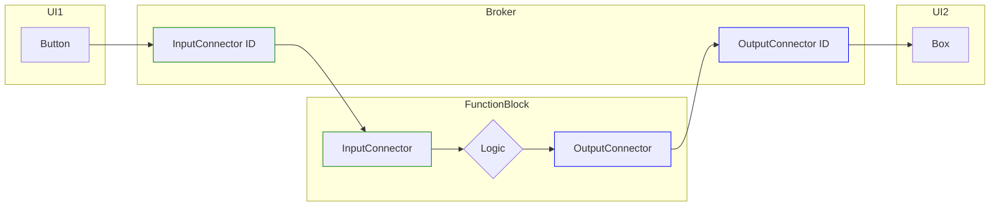
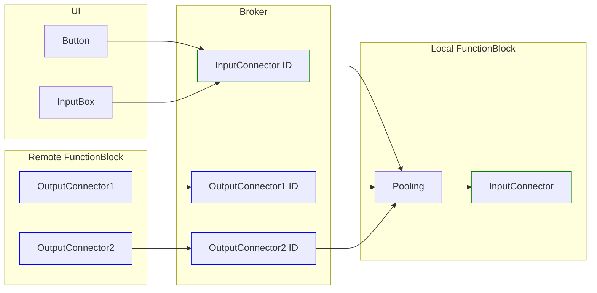

# Cluster Management

## EventEnabled

## Pooling

Pooling requires separate links to combine values into a single value before passing it to an input. [EventEnabled](#eventenabled) input connectors only use one link regardless of the amout of input controls.

